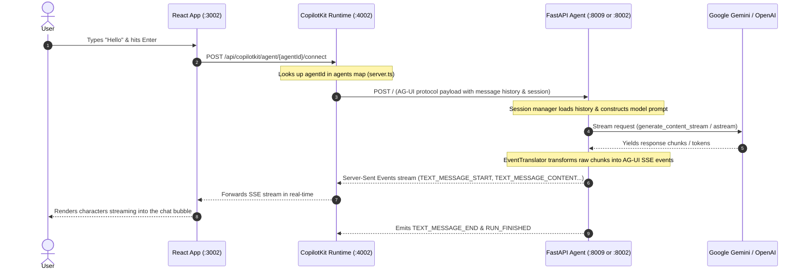

# System Architecture & Debugging Guide

Welcome to the internal engineering guide for this CopilotKit + Agentic Backend application. This document details the architectural design, end-to-end data flow, backend implementation, and common debugging workflows.

---

## 1. High-Level Architecture (3-Tier Design)

Unlike traditional web applications where a frontend either calls an API or directly connects to an LLM, this system implements an **Enterprise Agentic Architecture**:

```
┌─────────────────────────────────────────────────────────────┐
│ 1. Frontend Tier (React + Vite)                             │
│    URL: http://localhost:3002                               │
│    Role: Chat UI, message rendering, generative UI tools    │
└──────────────────────────────┬──────────────────────────────┘
                               │ HTTP Proxy (/api/copilotkit)
                               ▼
┌─────────────────────────────────────────────────────────────┐
│ 2. Agent Gateway Tier (CopilotKit Runtime / Node.js + Hono) │
│    URL: http://localhost:4002                               │
│    Role: Multi-agent routing, protocol bridge, agent discovery│
└───────────────┬─────────────────────────────┬───────────────┘
                │                             │
   agentId="default"                          agentId="gemini"
   AG-UI Protocol (SSE/POST)                  AG-UI Protocol (SSE/POST)
                │                             │
                ▼                             ▼
┌───────────────────────────────┐ ┌───────────────────────────┐
│ 3A. Python Backend: LangGraph │ │ 3B. Python Backend: ADK   │
│     URL: http://localhost:8002│ │     URL: http://localhost:8009│
│     File: main.py             │ │     File: adk_server.py   │
│     Model: Groq / OpenAI      │ │     Model: Google Gemini  │
└───────────────┬───────────────┘ └───────────┬───────────────┘
                │                             │
                ▼                             ▼
        Groq / OpenAI API             Google Gemini API
```

### 🔌 Port Mapping & Service Breakdown

|     Port     |     Service      |     Tech Stack               | Entry Point |
| :---:        | :---             | :---                         | :---      |
| **`3002`** | 🌐 **Frontend UI** | React 19 + Vite + TailwindCSS | [`frontend/src/App.tsx`](frontend/src/App.tsx) |
| **`4002`** | 🚪 **Agent Gateway** | Node.js + Hono + `@copilotkit/runtime` | [`frontend/server.ts`](frontend/server.ts) |
| **`8002`** | 🧠 **LangGraph Agent** | Python 3.12 + FastAPI + LangGraph | [`main.py`](main.py) |
| **`8009`** | 🤖 **Google ADK Agent** | Python 3.12 + FastAPI + Google GenAI | [`adk_server.py`](adk_server.py) |

#### Service Responsibilities:

- **🌐 Frontend Web App (`:3002`)**
  - **Role**: Renders the chat interface, streams response tokens in real-time, and displays Generative UI components.
  - **Proxy**: Automatically forwards all `/api/copilotkit` traffic to the gateway on port `4002`.

- **🚪 Agent Gateway / CopilotKit Runtime (`:4002`)**
  - **Role**: Multi-agent router and protocol translator. Reads `agentId` from the frontend and forwards to the target Python backend:
    - `agentId = "default"` ➔ routes to LangGraph (`http://localhost:8002`)
    - `agentId = "gemini"`  ➔ routes to ADK (`http://localhost:8009`)

- **🧠 LangGraph Python Agent (`:8002`)**
  - **Role**: Handles conversation logic and multi-turn session memory using `MemorySaver`.
  - **Models**: Supported via **Groq** (`openai/gpt-oss-120b`) or **OpenAI** (`gpt-4.1`).

- **🤖 Google ADK Python Agent (`:8009`)**
  - **Role**: Runs Google's Agent Development Kit with stateful in-memory conversation services.
  - **Models**: Supported via **Google Gemini** (`gemini-2.0-flash`).

---

## 2. End-to-End Chat & Response Lifecycle

Here is what happens under the hood when a user types `"Hello"` into the chat box:



### Why AG-UI Protocol?
Traditional REST APIs use Request-Response (`{"reply": "..."}`). Agents require a streaming protocol because:
1. **Token Streaming**: Users expect instant feedback rather than waiting 5–10 seconds for the entire response.
2. **Tool Execution Events**: The backend must inform the frontend when a tool is running (e.g. `TOOL_CALL_START`).
3. **Generative UI**: Agents can stream structured payloads that render interactive React components (charts, forms).
4. **Human-in-the-Loop**: The agent can yield an `INTERRUPT` event requiring user confirmation before proceeding.

---

## 3. Backend Code Breakdown

### `adk_server.py` (Google ADK + Gemini)

```python
import os
import uvicorn
from dotenv import load_dotenv
from fastapi import FastAPI
from ag_ui_adk import ADKAgent, add_adk_fastapi_endpoint
from google.adk.agents import LlmAgent

# 1. Load keys from .env
load_dotenv()

# 2. Define the core LLM Agent
gemini_agent = LlmAgent(
    name="assistant",
    model="gemini-3.8-flash",       # or "gemini-2.0-flash" for high capacity
    instruction="Be helpful and fun!",
)

# 3. Wrap with Stateful Session & Memory management
adk_agent = ADKAgent(
    adk_agent=gemini_agent,
    app_name="demo_app",
    user_id="demo_user",
    session_timeout_seconds=3600,   # Conversation memory persists for 1 hour
    use_in_memory_services=True,    # In-memory chat history
)

# 4. Bind the AG-UI SSE endpoint to FastAPI
app_adk = FastAPI()
add_adk_fastapi_endpoint(app_adk, adk_agent, path="/")

# 5. Start the ASGI Server
if __name__ == "__main__":
    uvicorn.run(app_adk, host="0.0.0.0", port=8009)
```

**Key Takeaways:**
- `LlmAgent`: Defines model identity, system prompt, and capabilities.
- `ADKAgent`: Handles conversation state. Without this, the model would forget previous messages.
- `add_adk_fastapi_endpoint`: Exposes an AG-UI compatible endpoint on `/` that streams Server-Sent Events.

---

### `main.py` (LangGraph + OpenAI)

```python
from fastapi import FastAPI
import uvicorn
from ag_ui_langgraph import add_langgraph_fastapi_endpoint
from copilotkit import CopilotKitMiddleware, LangGraphAGUIAgent
from langchain.agents import create_agent
from langchain_openai import ChatOpenAI
from langgraph.checkpoint.memory import MemorySaver

# 1. Memory checkpointer for multi-turn history
checkpointer = MemorySaver()

# 2. LangChain model with CopilotKit middleware
model = ChatOpenAI(model="gpt-4.1")

# 3. Create the LangGraph graph
graph = create_agent(
    model=model,
    tools=[],
    middleware=[CopilotKitMiddleware()],
    checkpointer=checkpointer,
    system_prompt="You are a helpful assistant..."
)

# 4. AG-UI wrapper for LangGraph
agent = LangGraphAGUIAgent(
    name="lesson2_agent",
    description="Lesson 2 chart agent",
    graph=graph,
)

# 5. Mount on FastAPI
app = FastAPI()
add_langgraph_fastapi_endpoint(app=app, agent=agent, path="/")
```

---

### `frontend/server.ts` (CopilotKit Node Runtime)

```typescript
import { CopilotRuntime, createCopilotEndpoint } from "@copilotkit/runtime/v2";
import { HttpAgent } from "@ag-ui/client";
import { LangGraphHttpAgent } from "@copilotkit/runtime/langgraph";
import { serve } from "@hono/node-server";

// 1. Define agent remote endpoints
const langGraphAgent = new LangGraphHttpAgent({
  url: process.env.LANGGRAPH_DEPLOYMENT_URL || "http://localhost:8002",
});

const adkAgent = new HttpAgent({
  url: process.env.ADK_AGENT_URL || "http://localhost:8009",
});

// 2. Register agents in the CopilotRuntime registry
const runtime = new CopilotRuntime({
  agents: {
    default: langGraphAgent, // Used when agentId="default" or omitted
    gemini: adkAgent,        // Used when agentId="gemini"
  },
});

// 3. Expose /api/copilotkit endpoint on port 4002
const app = createCopilotEndpoint({ runtime, basePath: "/api/copilotkit" });
serve({ fetch: app.fetch, port: 4002 });
```

---

## 4. How to Switch Between Agents

To toggle between OpenAI and Gemini:

1. Open [`frontend/src/App.tsx`](file:///Users/basavraj/Desktop/PERSONAL_DEV/frontend/src/App.tsx):
   - For **Gemini**: `export const agentId = "gemini";`
   - For **OpenAI**: `export const agentId = "default";`

2. Run the corresponding backend terminal:
   - For **Gemini**: `python adk_server.py` (Port 8009)
   - For **OpenAI**: `python main.py` (Port 8002)

---

## 5. Troubleshooting & Debugging Reference

### 1. `AggregateError [ECONNREFUSED]` on `/api/copilotkit/agent/...`
- **Symptom**: Frontend shows proxy error connecting to port 8002 or 8009.
- **Root Cause**: The Python backend matching `agentId` is not running.
- **Fix**: Check `App.tsx`:
  - If `agentId = "gemini"`, start `python adk_server.py`.
  - If `agentId = "default"`, start `python main.py`.

### 2. `Error code: 429 - insufficient_quota / credit_balance_exhausted`
- **Symptom**: OpenAI API returns 429 when sending a message.
- **Root Cause**: OpenAI developer account has $0 prepaid balance.
- **Fix**: Either add $5 at [platform.openai.com/billing](https://platform.openai.com/settings/organization/billing/) or switch to Gemini (`agentId = "gemini"`).

### 3. `ImportError: cannot import name 'ThinkingStartEvent' from 'ag_ui.core'`
- **Symptom**: `adk_server.py` fails on startup.
- **Root Cause**: `ag-ui-protocol 1.0.0` renamed `Thinking*` events to `Reasoning*`. `ag_ui_adk` expects `<1.0.0`.
- **Fix**: Run `pip install "ag-ui-protocol<1.0.0"`.

### 4. `404 Not Found: model models/gemini-2.5-flash is no longer available`
- **Symptom**: Google API rejects the model name.
- **Root Cause**: The course notebook specified a deprecated model.
- **Fix**: In `adk_server.py`, change model to `"gemini-3.8-flash"` or `"gemini-2.0-flash"`.

### 5. `503 Service Unavailable: This model is currently experiencing high demand`
- **Symptom**: Temporary capacity error from Google on free tier.
- **Fix**:
  1. Wait 5–10 seconds and retry.
  2. Or change model in `adk_server.py` to `model="gemini-2.0-flash"`.

### 6. `Port already in use` error
- **Fix**: Run in terminal to kill processes holding the ports:
  ```bash
  # Check what is using the port
  lsof -ti :3002 -ti :4002 -ti :8002 -ti :8009 | xargs kill -9
  ```

### 7. How to inspect traffic in Browser DevTools
- Open Chrome DevTools (`Cmd + Option + I` or `F12`).
- Go to the **Network** tab.
- Filter by `copilotkit`.
- Look at the `connect` request: under **EventStream**, you can watch live AG-UI protocol events arriving chunk-by-chunk!
