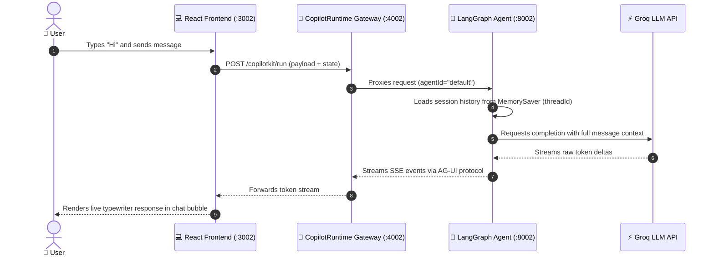

# CopilotKit Fullstack Agent

An enterprise agentic application featuring a React UI powered by **CopilotKit**, a multi-agent API Gateway, and backend agent servers built with **LangGraph** (Groq / OpenAI) and **Google ADK** (Gemini).

---

## 🏗️ Architecture

```text
React (Port 3002) ──► CopilotKit Runtime (Port 4002) ──► FastAPI Agent (Port 8002 / 8009) ──► LLM (Groq / OpenAI / Gemini)
```

### Port Mapping & Services

| Port | Service | Tech Stack | Entry Point | Description |
| :--- | :--- | :--- | :--- | :--- |
| **3002** | Frontend Web App | React 19, Vite, TailwindCSS | `frontend/src/App.tsx` | Chat UI with Generative UI support |
| **4002** | Agent Gateway | Node.js, Hono, `@copilotkit/runtime` | `frontend/server.ts` | Multi-agent router & protocol bridge |
| **8002** | LangGraph Agent | Python 3.12, FastAPI, LangGraph | `main.py` | Groq / OpenAI agent with session memory |
| **8009** | Google ADK Agent | Python 3.12, FastAPI, Google GenAI | `adk_server.py` | Gemini agent with in-memory state |

Detailed architectural flow and debugging instructions are available in [ARCHITECTURE_AND_DEBUGGING_GUIDE.md](ARCHITECTURE_AND_DEBUGGING_GUIDE.md).

---

## 🚀 Quickstart & Setup

### 1. Prerequisites
- **Python**: 3.10 – 3.12 (Python 3.12 recommended)
- **Node.js**: 20+

### 2. Installation

```bash
# 1. Clone the repository
git clone https://github.com/basavraj0909/copilotkit-fullstack-agent.git
cd copilotkit-fullstack-agent

# 2. Setup Python virtual environment
# On macOS / Linux:
python3 -m venv venv
source venv/bin/activate

# On Windows (PowerShell):
python -m venv venv
.\venv\Scripts\Activate.ps1

# On Windows (Command Prompt):
python -m venv venv
venv\Scripts\activate.bat

# 3. Install Python dependencies
pip install -r requirements.txt

# 4. Setup Frontend dependencies
cd frontend
npm install
cd ..
```

### 3. Configure API Keys

Copy the example environment file:
```bash
cp .env.example .env
```
*(On Windows Command Prompt: `copy .env.example .env`)*

Open `.env` and set your active key. For example, using **Groq** for high-speed inference:
```ini
# Active API Key (Groq)
GROQ_API_KEY=your_groq_api_key_here

# Optional: choose model (default: "openai/gpt-oss-120b")
# GROQ_MODEL=openai/gpt-oss-120b

# Unused / Inactive Keys (Keep commented out when not in use)
# OPENAI_API_KEY=your_openai_api_key_here
# GOOGLE_API_KEY=your_google_api_key_here
```

---

## 💻 Running the Application

To run the full stack, open **two separate terminal windows**:

### Terminal 1: Backend Agent Server
```bash
# Activate virtual environment:
# macOS/Linux: source venv/bin/activate
# Windows PowerShell: .\venv\Scripts\Activate.ps1
# Windows CMD: venv\Scripts\activate.bat

# Option A: Run LangGraph Agent (Groq / OpenAI) - Port 8002
python main.py

# Option B: Run Google Gemini Agent - Port 8009
# python adk_server.py
```

### Terminal 2: Frontend UI & CopilotKit Gateway
```bash
cd frontend
npm run dev
```

This starts (cross-platform on Windows, macOS, and Linux):
- **CopilotKit API Gateway** at `http://localhost:4002`
- **React Web App** at `http://localhost:3002`

👉 Open your browser at **[http://localhost:3002](http://localhost:3002)** to chat!

---

## 🛠️ Switching Between Agents

To switch the active agent in the frontend UI, open [`frontend/src/App.tsx`](frontend/src/App.tsx) and set `agentId`:

- **For Groq / OpenAI (`main.py` on `:8002`)**:
  ```tsx
  export const agentId = "default";
  ```
- **For Google Gemini (`adk_server.py` on `:8009`)**:
  ```tsx
  export const agentId = "gemini";
  ```

---

## 🧪 Testing

### 1. Automated Backend Test Suite
Run the built-in automated test suite to check health across all 3 tiers, response latency, and multi-turn session memory:
```bash
python test_agent.py
```

### 2. End-to-End (E2E) Browser Tests
Run automated Playwright tests simulating user interactions in the browser:
```bash
cd frontend
npm run test:e2e
```

---

## 🧰 Useful Commands

| Task                                | macOS / Linux                                                   | Windows (PowerShell)                                                                          | Windows (CMD)                                                                        |
| :---------------------------------- | :-------------------------------------------------------------- | :-------------------------------------------------------------------------------------------- | :----------------------------------------------------------------------------------- |
| **Activate venv**                   | `source venv/bin/activate`                                      | `.\venv\Scripts\Activate.ps1`                                                                 | `venv\Scripts\activate.bat`                                                          |
| **Run LangGraph backend**           | `python main.py`                                                | `python main.py`                                                                              | `python main.py`                                                                     |
| **Run Gemini backend**              | `python adk_server.py`                                          | `python adk_server.py`                                                                        | `python adk_server.py`                                                               |
| **Run Frontend & Gateway**          | `cd frontend && npm run dev`                                    | `cd frontend && npm run dev`                                                                  | `cd frontend && npm run dev`                                                         |
| **Run test suite**                  | `python test_agent.py`                                          | `python test_agent.py`                                                                        | `python test_agent.py`                                                               |
| **Kill hanging processes on ports** | `lsof -ti :3002 -ti :4002 -ti :8002 -ti :8009 \| xargs kill -9` | `Stop-Process -Id (Get-NetTCPConnection -LocalPort 3002,4002,8002,8009).OwningProcess -Force` | `for /f "tokens=5" %a in ('netstat -aon ^\| findstr :3002') do taskkill /f /pid %a`  |
| **Check open ports**                | `lsof -i :3002 -i :4002 -i :8002 -i :8009`                      | `Get-NetTCPConnection -LocalPort 3002,4002,8002,8009`                                         | `netstat -ano \| findstr LISTENING`                                                  |

---

## 💡 How It Works Under the Hood

### 🔄 The Life of a Single Message

When you send a message (e.g. `"Hi"`) from `http://localhost:3002`:



#### Step-by-Step Flow:

1. **Client Dispatch (`React :3002`)**  
   The user enters a prompt. CopilotKit hooks intercept the input, attach the active conversation state, and issue a request to the runtime gateway.

2. **Gateway Resolution (`Hono Gateway :4002`)**  
   The gateway checks `agentId = "default"` and routes the payload to the corresponding Python backend.

3. **Context Reconstruction (`LangGraph :8002`)**  
   LangGraph loads conversation history from `MemorySaver` using the session's `threadId`, constructs the complete prompt context, and executes the graph.

4. **Inference Execution (`Groq API`)**  
   Groq processes the prompt using ultra-low-latency LPU inference (`openai/gpt-oss-120b`) and streams token chunks back to LangGraph.

5. **SSE Protocol Streaming (`AG-UI Protocol`)**  
   LangGraph wraps the output into Server-Sent Events (SSE) via `CopilotKitMiddleware`. Tokens stream through the Gateway and render live in the React chat bubble.

---

### ⚖️ Traditional Chatbot vs. Agentic Architecture

| Feature                | Simple Chatbot (Toy Project)                     | This Project (Agentic Architecture)                                                          |
| :--------------------- | :----------------------------------------------- | :------------------------------------------------------------------------------------------- |
| **Architecture**       | Single-tier (React directly calls LLM REST API)  | **3-Tier Decoupled Gateway Pattern** (`React :3002` ➔ `Gateway :4002` ➔ `Agent :8002` ➔ `LLM`) |
| **Provider Agnostic**  | Hardcoded to a single vendor (e.g. OpenAI only)  | **Hot-Swappable Multi-Provider**: Toggle **Groq**, **OpenAI**, or **Gemini** via config      |
| **Streaming Protocol** | Static JSON payload (`{"reply": "..."}`)         | **AG-UI Streaming Protocol**: Server-Sent Events (SSE) streaming real-time token deltas      |
| **Execution Engine**   | Single prompt string sent to API                 | **LangGraph State Machine**: Directed cyclic graphs with conditional edges and tools         |
| **State & Memory**     | Ephemeral (lost on refresh or in `localStorage`) | **Server-Side Checkpointing**: Thread-safe persistence via `MemorySaver` and `threadId`      |
| **UI Interaction**     | Plain markdown text bubbles only                 | **Generative UI**: Agents dynamically control rich interactive React UI widgets               |

